# SOFTWARE DEVELOPMENT PORTFOLIO
### Professional Case Studies — Enterprise Business Systems

---

**Developer** | 3 Years of Professional Software Development Experience
**Specialisation** | Enterprise Applications, Business Management Systems, Full-Stack Development
**Location** | India

---

## ABOUT THIS DEVELOPER

I am a professional software developer with three years of hands-on experience designing, building, and deploying enterprise-grade business applications. My work extends beyond writing code — I architect, develop, and deliver complete software platforms that directly power real businesses and operate in live production environments.

This portfolio presents three major production systems I have built:

1. **EmiratesErp Platform** — A multi-company Enterprise Resource Planning system serving service-sector businesses.
2. **Emirates Laundry Management System** — A complete operational platform digitising every stage of a professional laundry and dry-cleaning business.
3. **Rentellor Property Rental Marketplace** — A high-performance digital real estate platform connecting tenants, property owners, and brokers.

All three are production-deployed, real-world applications — not demonstrations or academic projects. They handle live customer data, real financial transactions, daily operational workflows, and high-concurrency property searches.

---

## TECHNICAL SKILLS AT A GLANCE

| Skill Area | Capability |
|---|---|
| **Backend Development** | Java, Spring Boot, RESTful APIs, multi-tenant architecture |
| **Database Design** | MySQL, schema design, migrations, relational data modelling |
| **Security** | JWT authentication, role-based access control, password encryption |
| **Cloud & Integrations** | AWS (S3, Rekognition), Firebase, email gateways, SMS, WhatsApp |
| **Document Generation** | PDF reports, Excel exports, QR code generation |
| **Frontend Development** | React, Vite, Nginx |
| **DevOps & Deployment** | Docker, Docker Compose, containerised production deployments |
| **System Design** | Multi-tenant SaaS design, modular architecture, service separation |

---

## PART 1 — PROJECT: EmiratesErp SERVICE ERP PLATFORM

### 1.1 Project Overview

The EmiratesErp Platform is a **Software-as-a-Service Enterprise Resource Planning system** purpose-built for the India service sector. It allows multiple independent companies to subscribe to and operate a fully functional ERP from a single shared deployment, while keeping each company's data completely separate and secure.

The platform is commercially oriented — companies pay for a subscription, choose the modules they need, and are provisioned with their own isolated environment within minutes.

**Live Application Access:**
- **URL:** https://emirates.emirateserp.com/login
- **Email:** info@emirateserp.com
- **Password:** emirates7254

---

### 1.2 The Business Problem It Solves

Most small-to-medium businesses in the India manage their operations across disconnected tools — employee records in spreadsheets, sales in one system, accounts in another, procurement via email. This causes data fragmentation, manual reconciliation errors, and poor business visibility.

The EmiratesErp unifies all these functions in a single platform:

- A **sale** automatically creates an invoice and posts to the accounts module.
- A **payroll run** reads attendance records and generates payslips and WPS bank transfer files.
- A **warehouse receipt** triggers inventory updates across purchasing, sales, and accounts.
- An **HR action** like a resignation triggers automatic end-of-service calculation.

Everything is connected. Data flows automatically across modules. Human error is reduced.

---

### 1.3 Who Uses This System

| User | What They Do in the System |
|---|---|
| **Master Administrator** | Provisions new companies, manages subscriptions and modules |
| **Company Administrator** | Configures company settings, users, and roles |
| **HR Manager** | Manages employee records, attendance, leave, and payroll |
| **Sales Representative** | Creates quotations, manages customers and invoices |
| **Procurement Officer** | Raises purchase orders, manages suppliers and goods receipt |
| **Warehouse Staff** | Receives goods, assigns stock to locations, processes transfers |
| **Accountant** | Manages the chart of accounts, journals, VAT, and bank reconciliations |
| **Fleet Manager** | Manages vehicles, drivers, dispatch, and trip records |
| **CRM Officer** | Manages leads, contacts, follow-ups, deals, and pipeline |

---

### 1.4 How the System Is Architected

The platform is built on a **database-per-company isolation model**. Each company that subscribes gets its own completely separate database. This is a professional enterprise architecture pattern that guarantees:

- **Complete data isolation** — one company can never see another company's data, by design
- **Independent scalability** — any company's database can be moved to a dedicated server if needed
- **Compliance-ready** — satisfies data residency and privacy requirements per tenant
- **Safe backups** — each company's database can be backed up and restored independently

There are two databases in the system design:

**Central Management Database** — stores the list of all companies, their subscription details, and their database connection information.

**Per-Company Database** — every company that subscribes gets their own private database. Only the tables for the modules that company subscribes to are created. A company that subscribes to only HR and CRM does not get warehouse or fleet tables.

When a new company is registered, the system automatically creates their database, runs the necessary setup, and makes them live — without requiring any system restart.

---

### 1.5 Security Architecture

The system uses **two separate authentication environments**:

**Platform Administration Login** — only the master system administrator can log in here. This login manages companies, subscriptions, and platform-level settings.

**Company User Login** — each company's staff log in through this portal. Their credentials are stored in their own private database. A user from Company A cannot access Company B's system.

All authentication is handled via **JSON Web Tokens (JWT)**, an industry-standard stateless authentication method. Tokens carry the user's identity, their company, and their role — and expire after a defined period.

**Role-based access control** ensures that each user only sees and acts on data relevant to their role. An HR Manager cannot access accounts data. A sales representative cannot modify payroll settings.

**Passwords** are stored using BCrypt encryption — industry-standard one-way hashing that cannot be reversed.

---

### 1.6 ERP Modules — Detailed

---

#### MODULE 1 — HUMAN RESOURCE MANAGEMENT (HRMS)

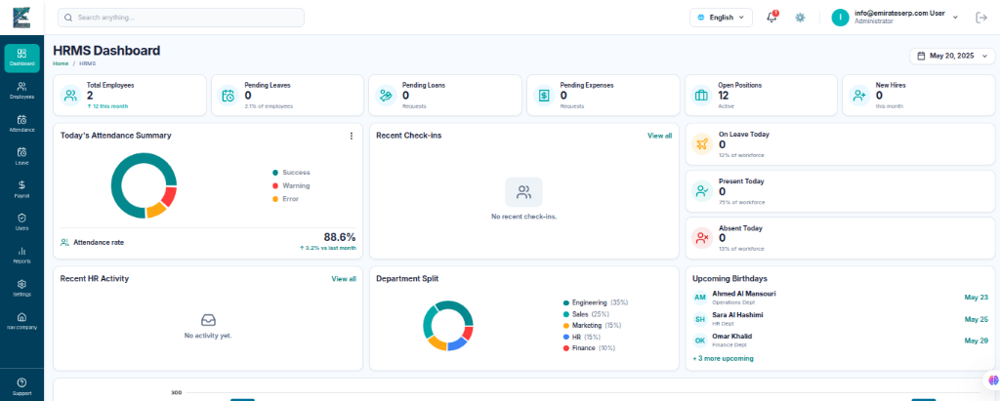

**Business Purpose:**

The India operates under strict labour law requirements — MOHRE compliance, WPS payroll transfers, visa processing, gratuity calculations, and Emiratisation reporting. Managing this manually creates compliance risk and administrative burden. This module digitises the entire employee lifecycle.

**What It Does:**

- Maintains a complete digital employee record: personal details, emergency contacts, visa information, bank account, documents, designation, department, and job grade
- Integrates with physical **biometric attendance devices** installed at company premises, automatically importing daily punch records
- Enforces **attendance policies**: shift timings, week-off rules, overtime rules, grace periods, late deduction rules
- Manages the full **leave lifecycle**: leave types (annual, sick, maternity, unpaid), leave policies, leave requests, approvals, and balance tracking
- Processes **monthly payroll**: reads attendance records, applies salary structures, deducts loans and absences, adds overtime and allowances
- Generates professional **payslips in PDF format** for every employee
- Produces the **WPS SIF file** (Wage Protection System bank transfer format) required by India banks for payroll submission
- Calculates **End-of-Service Benefit (EOSB/Gratuity)** per India Labour Law when an employee resigns or is terminated
- Manages **employee loans** and tracks repayment deductions from monthly payroll
- Tracks **employee expenses** and processes reimbursements
- Generates compliance reports:
  - **Emiratisation Report** — tracks India national hiring quota
  - **Labour Card Report** — tracks visa and labour card expiry dates
  - **Payroll Register Report** — full monthly payroll ledger
  - **Monthly Attendance Report** — daily attendance summary per employee
  - **Leave Accrual Report** — leave balance tracking
  - **Final Settlement Report** — total end-of-service payout breakdown
  - **Absconder Report** — tracks employees absent without authorisation

**Business Flow:**

```
Employee Hired
    → Profile Created (personal, visa, bank, job details)
    → Salary Structure Assigned (basic, housing, transport, allowances)
    → Biometric Device Registers Daily Attendance
    → End of Month: Payroll Run Initiated
    → System Calculates Net Salary (salary + allowances - deductions - loans)
    → Payslips Generated (PDF, one per employee)
    → WPS SIF File Generated for Bank Submission
    → On Resignation: EOSB Calculated and Final Settlement Produced
```

---

#### MODULE 2 — CUSTOMER RELATIONSHIP MANAGEMENT (CRM)

**Business Purpose:**

Without systematic lead tracking, sales teams lose prospects and miss follow-ups. This module provides a structured pipeline from first customer contact to deal closure and beyond.

**What It Does:**

- Captures leads from multiple sources — web forms, manual entry, and a public-facing intake form
- Assigns leads to sales representatives with clear ownership
- Tracks the lead through **defined pipeline stages** — each stage can be customised per business
- Logs all interactions: phone calls, emails, meetings, and tasks — against each lead
- Manages **follow-up scheduling** so no lead goes cold
- Generates **quotations and rental quotations** directly from leads
- Tracks deals and opportunities with expected values and closing probabilities
- Manages the customer company and contact database
- Provides a **calendar view** of scheduled follow-ups and events
- Tracks **CRM KPIs** (Key Performance Indicators) by team member and by period
- Generates sales pipeline reports and activity summaries

**Business Flow:**

```
Lead Captured (web / manual / referral)
    → Assigned to Sales Representative
    → Follow-ups Scheduled and Logged
    → Quotation Generated
    → Deal Closed
    → Customer Transferred to Sales Module
    → Reports: Pipeline Summary, KPI, Conversion Rate
```

---

#### MODULE 3 — SALES MANAGEMENT

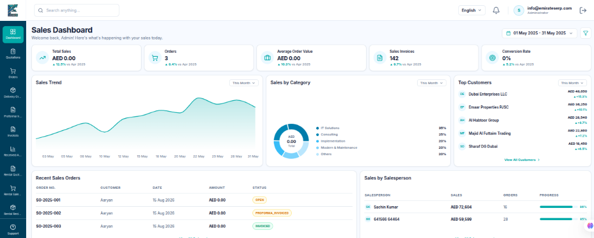

**Business Purpose:**

Managing the complete commercial transaction — from formal quotation through to invoice payment and delivery confirmation.

**What It Does:**

- Creates and manages **formal quotations** with line items, taxes, and discounts
- Converts quotations to **sales orders** with approval tracking
- Generates **proforma invoices** for advance payment collection
- Issues **sales invoices** and exports them as PDF documents
- Manages **delivery orders** — tracks what has been dispatched and when
- Handles **rental quotations and rental sales orders** for businesses with equipment hire
- Records the return of rented items
- Manages **credit notes** (refunds) and **debit notes** (additional charges)
- Provides a **Sales Dashboard** with revenue summaries, top customers, and pipeline value
- Generates sales reports by customer, by period, and by product

---

#### MODULE 4 — PURCHASE MANAGEMENT

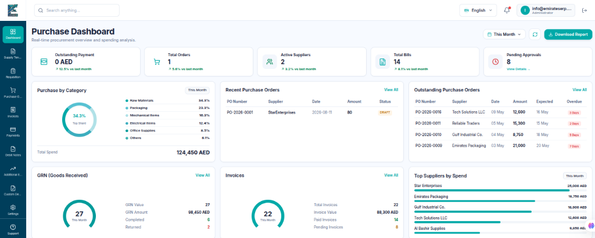

**Business Purpose:**

Procurement without a system leads to untracked commitments, duplicate orders, and inventory mismatches. This module controls the full purchasing cycle.

**What It Does:**

- Manages the **supplier database** with contact information and payment terms
- Creates **Request for Quotations (RFQs)** sent to multiple suppliers
- Accepts supplier responses and compares pricing
- Raises **Purchase Orders** with formal approval
- Records **Goods Receipt Notes (GRN)** when goods are received at the warehouse
- Processes **purchase invoices** matched against the GRN and PO
- Manages **purchase payments** to suppliers
- Handles **customs declarations** for imported goods
- Issues **debit notes** to suppliers for short deliveries or quality rejections
- Provides a **Purchasing Dashboard** with committed spend and pending approvals

---

#### MODULE 5 — WAREHOUSE MANAGEMENT

**Business Purpose:**

A business cannot manage what it cannot see. This module provides complete visibility into stock levels, locations, and movement — with RFID technology support.

**What It Does:**

- Manages a **hierarchical warehouse structure**: Warehouse → Zone → Floor → Rack → Shelf → Bin
- Records **Gate-In** operations when goods arrive from suppliers (linked to purchase GRN)
- Assigns received goods to **specific bin locations** in the physical warehouse
- Manages **RFID tags** attached to items and tracks their movement through the warehouse
- Records **Gate-Out** operations when goods leave the warehouse on dispatch
- Manages **stock transfers** between warehouses or between locations within a warehouse
- Processes **material requisitions** — departments raise requests, warehouse staff approves and issues stock
- Tracks **stock movements** with complete audit trail
- Sends **stock alerts** when items fall below minimum levels
- Manages **stock reservations** for committed sales orders
- Provides a **Warehouse Dashboard** with live stock levels and movement summaries
- Generates warehouse reports: stock valuation, movement history, bin content

**Business Flow:**

```
Goods Arrive from Supplier
    → Gate-In Recorded (linked to Purchase Order)
    → Quality Inspection Noted
    → RFID Tags Attached
    → Stock Assigned to Specific Bin Location
    → Inventory Updated in System
    → Department Raises Material Requisition
    → Warehouse Approves and Issues Stock
    → Gate-Out Recorded on Dispatch
    → Movement Log Maintained Throughout
```

---

#### MODULE 6 — ACCOUNTS & FINANCE

**Business Purpose:**

Every business transaction has a financial dimension. This module implements a complete, India-compliant double-entry accounting system.

**What It Does:**

- Manages the **Chart of Accounts** — the hierarchical account structure (assets, liabilities, income, expenses)
- Records **Journal Entries** — the foundation of double-entry bookkeeping, ensuring every financial transaction has balanced debit and credit postings
- Maintains the **General Ledger (GL)** — the complete record of all financial transactions
- Manages **bank accounts** and reconciles them against bank statements
- Processes **vendor payments** and **customer receipts**
- Tracks **post-dated cheques (PDCs)** — common in India business — and manages their status lifecycle
- Handles **India VAT** — VAT groups, VAT rates, VAT tax transactions, and VAT reporting
- Processes **cash flow** items and provides a cash flow statement
- Manages **AP/AR netting** (mutual settlement between a party who is both customer and supplier)
- Maintains **sub-ledgers** for inventory, fixed assets, employees, and parties
- Generates **financial reports**: Trial Balance, Income Statement, Balance Sheet, Cash Flow Statement, Bank Reconciliation Report

---

#### MODULE 7 — FLEET MANAGEMENT

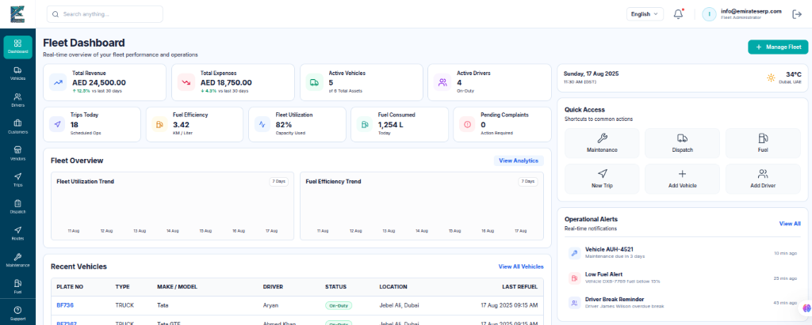

**Business Purpose:**

For businesses operating delivery, field service, or transport operations, fleet management is a core function. Ad-hoc vehicle use without tracking leads to cost leakage and poor accountability.

**What It Does:**

- Maintains the **vehicle registry**: registration details, insurance, Mulkiya, maintenance schedule
- Manages **driver profiles**: licence information, contact details, and performance records
- Creates and assigns **trips** to drivers: route, customer, cargo, scheduled times
- Manages the **dispatch board** — real-time view of vehicle and driver allocation
- Captures **proof of delivery** — driver uploads delivery confirmation after each trip
- Logs **fuel entries** per vehicle with cost tracking
- Records **vehicle maintenance** events and associated costs
- Tracks **driver performance** metrics — on-time rate, trip completion
- Provides a **Fleet Dashboard** with vehicle utilisation and cost summaries
- Generates fleet reports: trip history, fuel consumption, maintenance costs

---

#### MODULE 8 — FIXED ASSET MANAGEMENT

**Business Purpose:**

Companies must track physical assets — machinery, furniture, computers, vehicles — and calculate their depreciation for accurate financial statements and tax compliance.

**What It Does:**

- Maintains a **fixed asset register** with all company assets
- Organises assets into **categories, classes, and groups** (e.g., IT Equipment > Laptops)
- Calculates **depreciation** on a scheduled basis and posts to the accounts module
- Records **asset disposal** when equipment is retired or sold
- Integrates with the **accounts module** via sub-ledger entries for all asset transactions
- Generates **depreciation schedules** and asset valuation reports

---

#### MODULE 9 — APPLICANT TRACKING SYSTEM (ATS)

**Business Purpose:**

Recruitment in the India often involves multiple staffing agencies and hundreds of applicants. Without a system, tracking candidates is disorganised and key talent is lost.

**What It Does:**

- Manages the **applicant database** with full candidate profiles: personal details, education, employment history, certifications, and documents
- Integrates with a **resume parser** — uploaded CV documents are automatically processed and relevant data extracted
- Manages **staffing vendor relationships** — agencies, submission formats, and fee agreements
- Schedules and records **interviews** with multiple interviewers
- Manages **job bands and grades** for structured hiring
- Tracks applicant **consent and data privacy** — including a public-facing consent response portal
- Moves candidates through a defined **hiring pipeline** from shortlisting to offer to joining

---

#### MODULE 10 — POINT OF SALE (POS)

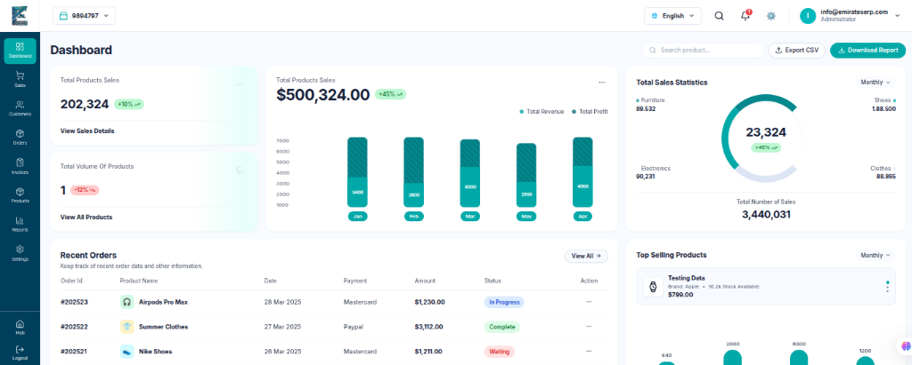

**Business Purpose:**

For businesses with walk-in counter sales, this module provides a clean, fast point-of-sale interface integrated with the main inventory and accounts system.

**What It Does:**

- Manages a **product catalogue** with categories, variants, and QR codes for quick scanning
- Processes **walk-in sales** and generates receipts
- Manages **POS sessions** (opening float, cash drawer, session closing)
- Synchronises sales data with the **inventory module** (stock deducted on sale)
- Posts sales to the **accounts module** (revenue, cash, tax)
- Supports QR code-based product scanning for fast checkout
- Provides uploaded product images for a visual catalogue

---

#### MODULE 11 — MATERIALS & REQUISITION MANAGEMENT

**Business Purpose:**

Departments that need materials for projects or operations must be able to request them formally, and those requests must be tracked and approved.

**What It Does:**

- Allows departments to raise **material requisitions** with specified items and quantities
- Routes requisitions through an **approval workflow** (submit → approve / reject)
- On approval, triggers a **material issue** from the warehouse
- Tracks **material consumption** by department and by project
- Provides visibility into pending, approved, and fulfilled requisitions

---

#### MODULE 12 — PROJECT MANAGEMENT

**Business Purpose:**

Service businesses that deliver project-based work need to track project milestones, tasks, and associated costs.

**What It Does:**

- Creates and manages **projects** with defined scope and timeline
- Breaks projects into **tasks** assigned to team members
- Tracks **milestones** and completion progress
- Provides project-level cost and timeline reporting

---

#### MODULE 13 — NOTIFICATION SYSTEM

**Business Purpose:**

Keeping the right people informed at the right time reduces errors, speeds up approvals, and improves operational coordination.

**What It Does:**

Delivers automated notifications across six channels:

| Channel | Description |
|---|---|
| **Email** | Templated email notifications with HTML formatting |
| **SMS** | Text message alerts for urgent operational updates |
| **WhatsApp** | WhatsApp Business API integration for customer and staff messaging |
| **Telegram** | Telegram bot notifications for internal team updates |
| **In-App** | Real-time notifications within the ERP web interface |
| **Webhook** | Programmatic integration with third-party systems via HTTP callbacks |

All channels support **templating** — messages are pre-authored with dynamic fields that fill in automatically (employee name, order number, due date, etc.).

---

### 1.7 How Modules Connect — The Integrated Business Flow

The ERP's power comes from how modules work together automatically:

```
CUSTOMER-TO-CASH FLOW
━━━━━━━━━━━━━━━━━━━━━━
Lead Captured in CRM
    ↓
Quotation Sent to Customer
    ↓
Order Confirmed → Sales Order Created
    ↓
Warehouse Releases Stock → Delivery Order Raised
    ↓
Invoice Generated → Posted to Accounts
    ↓
Payment Received → Bank Account Updated
    ↓
Bank Reconciled Against Statement

PURCHASE-TO-PAY FLOW
━━━━━━━━━━━━━━━━━━━━━
Department Raises Material Requisition
    ↓
Procurement Issues RFQ to Suppliers
    ↓
Best Offer Selected → Purchase Order Raised
    ↓
Goods Received → GRN Recorded → Inventory Updated
    ↓
Supplier Invoice Processed → Accounts Payable Updated
    ↓
Payment Made to Supplier

HIRE-TO-PAY FLOW
━━━━━━━━━━━━━━━━
Candidate Sourced via ATS
    ↓
Interview Scheduled and Conducted
    ↓
Offer Made → Employee Onboarded in HRMS
    ↓
Biometric Device Registers Daily Attendance
    ↓
Monthly Payroll Run Processes All Employees
    ↓
Payslips Generated → WPS File Sent to Bank
    ↓
Payroll Posted as Journal Entry in Accounts
    ↓
On Exit: EOSB Calculated → Final Settlement Processed
```

---

### 1.8 ERP Technology Summary

| Area | Technology Used |
|---|---|
| **Primary Language** | Java 21 |
| **Application Framework** | Spring Boot 3.5 |
| **Database** | MySQL 8.x |
| **Authentication** | JWT Tokens with Spring Security |
| **Password Security** | BCrypt Encryption |
| **Database Migrations** | Liquibase (version-controlled schema changes) |
| **PDF Generation** | iText 7 + OpenPDF |
| **Excel Exports** | Apache POI |
| **QR Codes** | ZXing Library |
| **Document Parsing** | Apache Tika (for resume processing in ATS) |
| **Frontend** | React + Vite (served by Nginx) |
| **Deployment** | Docker + Docker Compose |
| **API Documentation** | Swagger / OpenAPI |
| **Connection Pooling** | HikariCP (one pool per company) |

---

### 1.9 ERP Deployment Architecture

The system runs as three containerised services:

| Service | Role |
|---|---|
| **Database Server** | MySQL 8.0 — stores all company data in isolated databases |
| **Application Server** | Spring Boot backend — handles all business logic and APIs |
| **Web Server** | Nginx serving the React frontend — the user-facing interface |

All sensitive configuration (database credentials, authentication secrets, email settings) is passed as environment variables — no sensitive information is hardcoded into the application.

---

### 1.10 Key Engineering Problems Solved

#### Multi-Company Data Isolation
Each company's data is stored in a completely separate database. The routing between databases happens invisibly at the infrastructure level — all business logic code remains the same for every company. A new company can be provisioned and made live within the running system without any restart or downtime.

#### Module Subscription Gating
When a company subscribes to HRMS only, only HRMS-related database tables are created for them. When they later upgrade to include CRM, only CRM tables are added — nothing else is touched. This ensures clean, minimal databases per tenant.

#### Parallel Startup for Multiple Companies
When the system starts up and multiple companies are registered, all company databases are initialised simultaneously using parallel processing (Java 21 Virtual Threads). This keeps startup time fast regardless of how many companies are registered.

#### India Compliance Built-In
India-specific business rules — WPS payroll format, EOSB gratuity calculations, VAT treatment, and Emiratisation tracking — are built directly into the system, not bolted on.

---

### 1.11 Business Value Summary

| Pain Point | How the ERP Resolves It |
|---|---|
| Scattered employee records in spreadsheets | Central, role-controlled employee database |
| Manual payroll calculation errors | Automated payroll engine with payslip and WPS file generation |
| No audit trail on financial postings | Double-entry accounting with complete audit log |
| Lost leads and missed follow-ups | CRM pipeline with stage tracking and follow-up scheduling |
| Unknown stock levels | Warehouse module with bin-level inventory and movement history |
| Manual India compliance reporting | Automated Emiratisation, HR Compliance, and Labour Card reports |
| Uncontrolled procurement spending | Purchase order approval workflow with committed spend visibility |

---
---

## PART 2 — PROJECT: EmiratesErp LAUNDRY MANAGEMENT SYSTEM

### 2.1 Project Overview

The Emirates Laundry Management System is a purpose-built, end-to-end software platform for professional laundry and dry-cleaning businesses. It digitises every stage of the laundry operation — from the moment a customer brings in their garments, through the cleaning and quality control process, to delivery and billing.

The system is designed for businesses operating **multiple store branches** (counter collection points) and a **central processing plant**, with a driver team handling pickup and delivery logistics.

**Live Application Access:**
- **URL:** https://laundary.emirateserp.com/
- **Email:** info@emirateserp.com
- **Password:** emirates7254

---

### 2.2 The Business Problem It Solves

A commercial laundry without software operates on paper tags attached to garments, handwritten order lists, manual billing, and verbal communication between the store counter, plant floor, and delivery drivers. The consequences are:

- **Lost garments** — paper tags fall off, orders get mixed up
- **Billing errors** — wrong prices charged, items missed from invoices
- **No operational visibility** — management cannot see how many items are in process, where delays are, or what the day's revenue looks like
- **Missed deliveries** — no systematic driver coordination
- **No quality enforcement** — garments returned with defects because there is no formal quality check

The Emirates Laundry system eliminates every one of these problems:

- Every garment receives a unique **QR code** — it is digitally traceable from intake to delivery
- Billing is **automatic** based on services selected, upcharges applied, and customer pricing
- Managers see a **live operational dashboard** — orders, items in process, ready items, and pending deliveries
- Drivers are assigned orders and confirm deliveries with **proof of delivery**
- A formal **7-point quality control checklist** is enforced before any garment leaves the plant

---

### 2.3 Who Uses This System

| User | Role |
|---|---|
| **Business Owner / Admin** | Full visibility and control across all branches |
| **Store Manager** | Manages daily counter operations and staff |
| **Counter Staff (Employee)** | Creates orders, registers customers, handles payments |
| **Plant Worker** | Processes garments through washing, QC, and packing |
| **Driver** | Collects and delivers orders via the driver app |
| **Call Centre Agent** | Takes telephone orders for pickup and delivery |

---

### 2.4 How the System Is Architected

The Laundry system operates as a **multi-branch platform** — one system serves the entire business, with all branches sharing a central database. Each branch's data is clearly separated so branch managers only see their branch's operations.

**Branch Types in the System:**

- **Counter Branch** — a retail collection/drop-off point where customers bring garments
- **Plant Branch** — the central processing facility where all cleaning happens

Every piece of data in the system — every order, every customer record, every garment — is tagged with the company and branch it belongs to. This keeps operations clean across multiple locations.

---

### 2.5 The Complete Garment Lifecycle — Stage by Stage

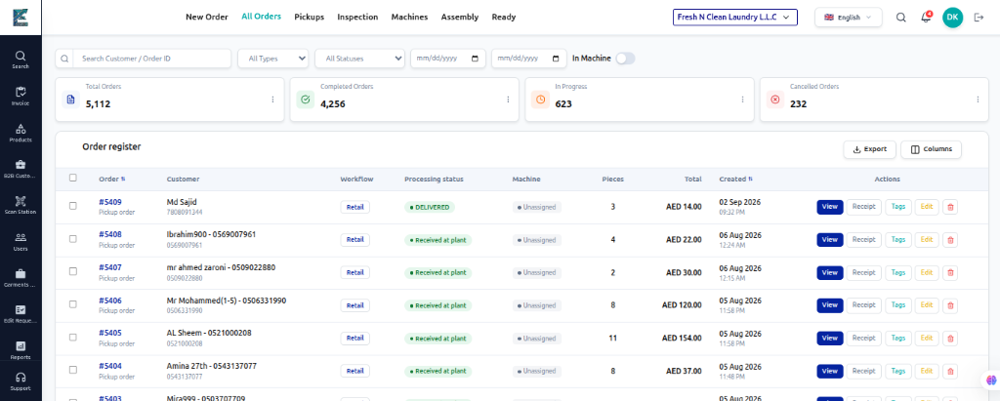

This is the core operational flow of the Laundry system. Every stage is tracked in real time.

---

#### STAGE 1 — ORDER CREATION (At Counter or via Pickup Request)

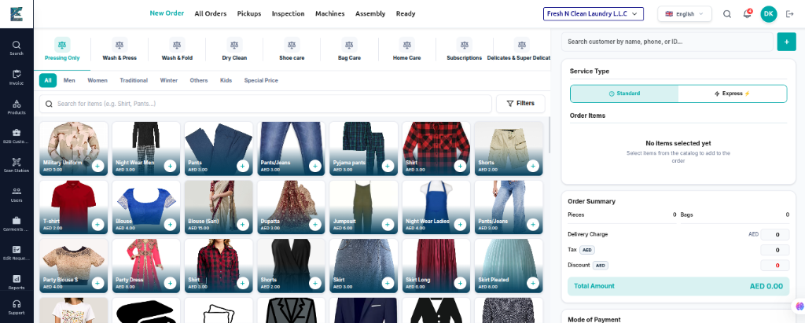

A customer arrives at a counter branch or calls for a pickup.

The counter staff creates an **Order Header** — the parent record for the entire visit:
- Customer details (linked from the customer database)
- Scheduled pickup time and delivery time
- Delivery address with GPS coordinates
- Payment type (cash, card, credit account)
- Any special notes

Under the Order Header, individual **Order Items** are added — one for each type of garment or service:
- Service type (wash, dry clean, iron, alterations, etc.)
- Quantity
- Price per unit (from the standard price list or the customer's custom price list)
- Any upcharges (express service, starch, special handling)
- Notes specific to the item

**Walk-in orders**, **self-pickup orders**, and **delivery orders** are all supported as distinct order types.

---

#### STAGE 2 — GARMENT TAGGING (Digital Identity)

For each order item, individual **garments** are registered in the system:

- A unique **QR code** is generated for every single garment
- The QR code is printed and physically attached to the garment as a tag
- The garment record captures: colour, brand, fabric type, care label instructions
- If any damage is noticed on intake, it is recorded with a description and photographs
- Damaged items requiring customer approval are flagged — the customer is notified and must decide: repair, proceed with cleaning, or return without washing
- The garment is assigned a **bin category** based on how it will be cleaned:
  - Wash — Lights
  - Wash — Darks
  - Dry Clean
  - Press Only
  - Repair
  - Stain Treatment

From this point forward, every garment is individually trackable by scanning its QR code.

---

#### STAGE 3 — PLANT PROCESSING (Washing, Drying, Pressing)

Garments arrive at the plant and are grouped into **processing batches**:

- Each batch is assigned to a specific **machine** (washer or dryer)
- A **wash formula** is applied to the batch — specifying the chemicals, temperature, and cycle duration appropriate for the fabric type
- As processing proceeds, the batch status advances through stages:
  - **Washing → Drying → Pressing → Folding → Complete**
- Each garment's individual status is updated in parallel

This stage gives the plant manager complete visibility: how many items are in which machine, when each batch is due to complete, and where bottlenecks exist.

---

#### STAGE 4 — QUALITY CONTROL (QC)

Before any garment is moved to storage or dispatch, it must pass a **7-point Quality Control checklist**:

| QC Checkpoint | What Is Checked |
|---|---|
| No Wrinkles | Garment is wrinkle-free after pressing |
| Sleeves Aligned | Shirt/jacket sleeves are properly aligned |
| No Stains | No residual stains from cleaning |
| Collar Rolled Correctly | Collar sits correctly |
| No Double Creases | No unintended crease lines |
| Care Instructions Followed | Special care instructions were applied |
| Quantity Matches Order | Number of items matches what the customer brought in |

If any checkpoint fails, the garment is returned for re-processing. The QC officer records the rejection reason. Only garments passing all checks proceed to storage and delivery.

---

#### STAGE 5 — CONVEYOR & STORAGE MANAGEMENT

After passing QC, garments are stored until they are ready for collection or delivery. The system manages the physical infrastructure:

- Garments are assigned to specific **rack slots** — physical storage positions in the plant
- The system supports multiple **conveyor belt types**:
  - Hanging conveyor belts (for shirts, suits)
  - Rack conveyors (for folded items)
  - Transfer belts (between workstations)
- Conveyor belt **operational status** is tracked: running, stopped, under maintenance, fault
- **Hanger tracking** — hangers are registered and linked to garments on the hanging conveyor

This ensures that when an order is ready to be dispatched, staff can locate every garment instantly.

---

#### STAGE 6 — READY NOTIFICATION & DISPATCH

When all garments in an order pass QC and are stored, the order status is set to **Ready**.

The customer is automatically notified through their preferred channel:
- Push notification (mobile app)
- WhatsApp message
- SMS
- Email

**Delivery orders** are created for orders requiring driver collection and delivery:
- Driver is assigned to the order
- GPS coordinates of the delivery address are confirmed
- Driver completes the delivery and uploads **proof of delivery** (a photo or signature)
- Delivery timestamp is recorded per garment

For walk-in customers, they are notified to collect their items from the counter.

---

#### STAGE 7 — INVOICING & PAYMENT

Once the order is delivered or collected, a **professional invoice** is generated:

| Invoice Field | Description |
|---|---|
| Invoice Number | Unique, auto-generated reference |
| Sub-Total | Sum of all order items |
| Tax Amount | Calculated VAT/tax |
| Discount Amount | Customer discount or promotional discount |
| Delivery Charge | If home delivery was provided |
| Total Amount | Final amount due |
| Amount Paid | Recorded at point of payment |
| Balance Due | Remaining balance if partial payment |

**Invoice Types:**

- **Per-Order Invoice** — issued immediately after order completion (for retail customers)
- **Monthly Statement Invoice** — issued at end of billing cycle (for corporate customers on account)

Corporate customers (hotels, hospitals, offices) are managed with a **Service Contract** defining their billing cycle (weekly or bi-weekly), their negotiated pricing, and any special terms.

**Payment Methods:** Cash, card, customer credit account

**Saved cards** are supported for repeat customers who prefer card payments.

---

### 2.6 Customer Management

The system maintains a complete customer database covering both retail and corporate accounts.

**Retail Customer Records:**
- Name, phone, secondary phone, email
- Primary address with GPS coordinates
- Separate pickup and delivery addresses
- Discount percentage, credit balance
- Payment preference and invoice style
- Marketing opt-in preference
- Customer notes (visible to staff) and private notes (management only)
- Document records (e.g., corporate account agreements)

**Corporate Customer Features:**
- Corporate profile with company details
- Multiple branch locations, each with its own billing address
- Service Contract with negotiated pricing and billing cycle
- Custom price list — different prices from the standard rate card
- FOC (Free of Charge) quota — free items allowance tracked and enforced
- Monthly statement generation instead of per-order invoicing

**Customer Status Management:**
Active, Inactive, Pending, On Hold, Suspended — each state controls what actions can be taken for the customer.

---

### 2.7 Product & Pricing Management

The pricing system supports the complexity of a commercial laundry:

**Service Types Supported:**
- Washing (by item)
- Dry Cleaning (by item)
- Ironing / Pressing
- Shoe Cleaning
- Wash & Fold (by weight or bag)
- Self-Service Laundry
- Alterations and Repairs
- Sneaker Cleaning
- Shoe Repair

**Pricing Models:**
- Standard price per item
- Express price (premium for urgent orders)
- Price per kilogram (for weight-based services)
- Price per square metre (for rugs and curtains)
- Custom price lists per customer

**Upcharges:**
Services can have additional charges applied on top of the base price — for example: starch, extra rinse, special fabric handling. These can be configured as:
- Fixed amount additions
- Per-unit additions
- Percentage additions

**Product Organisation:**
Services are organised into sections and sub-sections for clear display in the ordering interface (e.g., Section: Clothing → Sub-section: Shirts, Trousers, Jackets).

---

### 2.8 Machine & Formula Management

The system manages the plant's machinery and the formulas used for each wash cycle.

**Machine Management:**
- Machine registry with type and status
- Machine assignment to process batches
- Machine cycle tracking (duration, settings)
- Machine issue logging (downtime, faults)
- Machine modifier configurations

**Wash Formula Management:**
- Named formulas (e.g., "Whites — Hot", "Delicates — Cold", "Dry Clean Solvent")
- Each formula specifies: chemicals used, wash temperature, cycle duration in minutes
- Formulas are assigned to process batches, ensuring consistency and compliance with fabric care requirements

---

### 2.9 Pickup & Delivery Logistics

**Driver Management:**
- Driver profile with status: Active, Inactive, Suspended
- Access mode controls what the driver can do in the app: pickup only, delivery only, cash collection
- Driver assignment to orders

**Pickup and Delivery Time Slots:**
The system manages defined time slots for scheduled pickups and deliveries, allowing customers to book specific time windows.

**Proof of Delivery:**
After completing a delivery, the driver uploads proof (photograph or signature). This is stored against the order record.

**Delivery Order Records:**
A formal delivery order is created for every dispatched order, listing all items, destination address, and driver information.

---

### 2.10 Notification System (4 Channels)

The system sends automated notifications to customers at every stage of their order:

| Channel | Technology | Use Cases |
|---|---|---|
| **Push Notification** | Firebase Cloud Messaging | Order received, order ready, driver on the way |
| **WhatsApp** | WhatsApp Business API | Order confirmations, collection reminders |
| **SMS** | SMS Gateway | Delivery updates, ready notifications |
| **Email** | SMTP (Zoho Mail) | Invoices, statements, order summaries |

Each channel supports **pre-designed templates** with dynamic fields. Every notification sent is logged for traceability.

---

### 2.11 Reporting & Business Visibility

**Operational Reports:**
- Orders summary by date, branch, and status
- Garments in process by stage
- Ready items waiting for collection or dispatch
- Driver delivery performance

**Financial Reports:**
- Daily revenue by branch
- Invoice aging report (unpaid, partially paid, paid)
- Customer statement history
- Monthly statement summaries for corporate accounts

---

### 2.12 Security & Access Control

**User Registration and Verification:**
New users register with email verification via a one-time password (OTP). Accounts are only activated after OTP confirmation.

**Role-Based Access:**
Six user roles with different access levels — Admin, Manager, Employee, Owner-Operator, Custom, and Driver.

**Fine-Grained Permissions:**
Beyond roles, the system supports 25+ individual permission settings that can be granted or denied per user, such as:
- Edit orders
- Edit completed orders
- Edit paid orders
- Delete orders
- Add discounts to orders
- Manage products and prices
- Manage user accounts
- Manage invoices
- Access financial metrics
- Export data
- Manage refunds

**Rate Limiting:**
The system enforces API rate limits to prevent abuse and protect platform stability.

---

### 2.13 Laundry Technology Summary

| Area | Technology Used |
|---|---|
| **Primary Language** | Java 17 |
| **Application Framework** | Spring Boot 3.5 |
| **Database** | MySQL 8.x |
| **Authentication** | JWT Tokens with OTP email verification |
| **Password Security** | BCrypt Encryption |
| **Database Migrations** | Liquibase |
| **PDF Generation** | OpenPDF |
| **Excel Exports** | Apache POI |
| **QR Code Generation** | ZXing Library |
| **Push Notifications** | Firebase Cloud Messaging (FCM) |
| **Cloud File Storage** | AWS S3 |
| **Image Analysis** | AWS Rekognition |
| **Rate Limiting** | Bucket4j |
| **Email** | Spring Mail with Zoho SMTP |
| **Frontend** | React + Vite (Clean Cloud interface) |
| **Deployment** | Docker + Docker Compose |

---

### 2.14 Deployment Architecture

The system runs as three containerised services:

| Service | Port | Role |
|---|---|---|
| **Database Server** | Internal | MySQL 8.0 — all business data |
| **Application Server** | 8081 | Spring Boot backend |
| **Web Frontend** | 8082 | React interface served by Nginx |

The system has been deployed to a live remote server, confirming it is a production application.

---

### 2.15 Key Engineering Problems Solved

#### Garment Traceability at Scale
A commercial laundry processes thousands of garments per week. Each garment receives a unique QR code at intake. From that moment, every stage of its journey is recorded: which machine it went through, which wash formula was applied, whether it passed QC, which rack slot it is stored in, and when it was delivered. Any garment can be located instantly by scanning its QR code.

#### Structured Quality Enforcement
Rather than relying on individual judgment, quality control is formalised into a mandatory 7-point checklist that must be completed before any garment can be marked as ready. Rejected items are automatically routed back for re-processing.

#### Corporate Billing Complexity
Corporate clients require consolidated monthly statements rather than individual order invoices. The system handles both billing modes simultaneously — retail customers receive per-order invoices while corporate clients on account receive end-of-cycle consolidated statements.

#### Multi-Channel Customer Communication
Different customers prefer different notification channels. The system maintains customer notification preferences and sends automated messages through the appropriate channel (push, WhatsApp, SMS, or email) at each key order milestone.

---

### 2.16 Business Value Delivered

| Business Problem | System Solution |
|---|---|
| Garments lost due to paper tag failures | Every garment has a unique digital QR code — loss is eliminated |
| Billing errors from manual calculation | Billing is automatic based on pre-configured pricing and upcharges |
| No visibility into plant operations | Live dashboard shows all orders by stage, all garments in process |
| Poor quality control | Mandatory 7-point QC checklist enforced before every dispatch |
| Missed delivery coordination | Driver app with assigned orders, GPS addresses, and proof of delivery |
| Inconsistent wash formulas | Named wash formulas with defined chemicals, temperature, and duration |
| Corporate invoicing complexity | Monthly statements auto-generated by billing cycle per corporate account |
| Customer service gaps | Automated notifications via push, WhatsApp, SMS, and email at every stage |

---
---

## PART 3 — PROJECT: RENTELLOR PROPERTY RENTAL MARKETPLACE

### 3.1 Project Overview

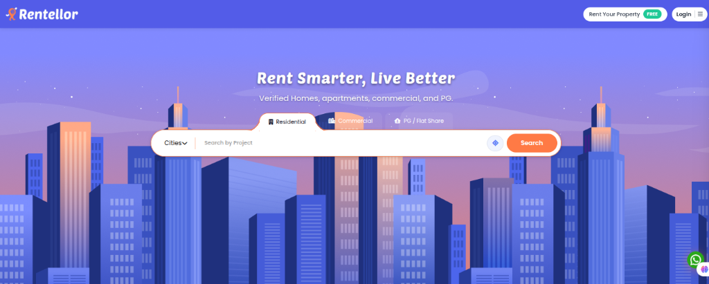

Rentellor is a high-performance **digital real estate rental marketplace** designed to connect tenants, property owners, and brokers across residential, commercial, and shared PG/Flat accommodation categories.

The platform handles real-time property searches, multi-criteria filtering, verified property listings, lead management, and direct owner contacts.

**Live Application Access:**
- **URL:** https://rentellor.com/

---

### 3.2 The Business Problem It Solves

Traditional real estate portals suffer from slow search responses, fake or unverified listings, inefficient lead routing, and poor scaling under high traffic.

Rentellor resolves these challenges:
- **Sub-50ms Indexed Search** — High-speed location, city, amenity, and budget searches powered by Elasticsearch.
- **Direct Owner-Tenant Communication** — Streamlined lead capture and instant notification routing via SMS, WhatsApp, and Email.
- **High Concurrency Architecture** — Engineered using Spring Boot 3.5 on Java 17 to support thousands of concurrent property searches without performance degradation.
- **Rich Media & Media Storage** — Fast property photo gallery rendering and video tours powered by AWS S3 and CloudFront CDN integration.

---

### 3.3 Interactive Property Search & Filtering

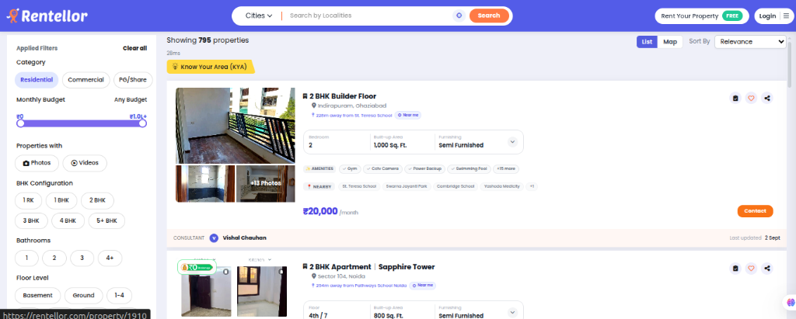

The property search engine provides users with a comprehensive filtering system:
- **Category Selection:** Residential, Commercial, PG / Flat Share
- **Budget Slider:** Flexible monthly rent filtering
- **BHK & Property Type:** 1 RK, 1 BHK, 2 BHK, 3 BHK, 4 BHK+
- **Location & Area Insights:** Locality search, map views, and "Know Your Area" (KYA) insights
- **Amenities & Media Filters:** Instant filtering for verified photos, video tours, gym, parking, power backup, and security features

---

### 3.4 Mobile Application Experience (React Native App)

The Rentellor Mobile Application provides a native experience for tenants and property owners:

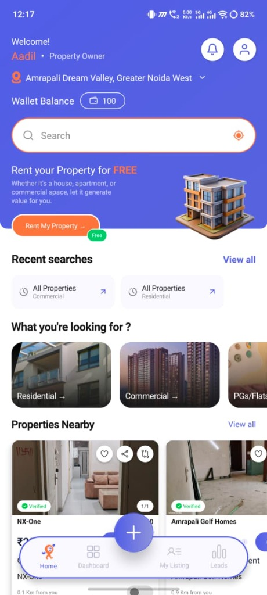

- **Owner & Tenant Dashboards:** Customised mobile home view tailored by role (Property Owner view with wallet balance, quick listing actions, and nearby properties).
- **Instant Locality & Property Search:** Quick access to residential, commercial, and PG/Flat share listings with geo-aware nearby search.

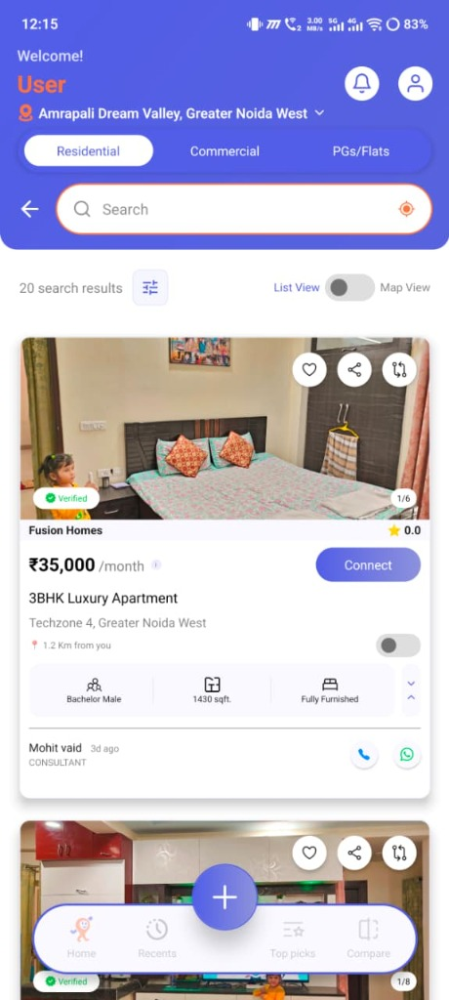

- **Detailed Property Cards:** Displays verified badges, room configuration, monthly rent, furnishing status, distance calculation, and direct owner/consultant contact actions via WhatsApp and Phone.

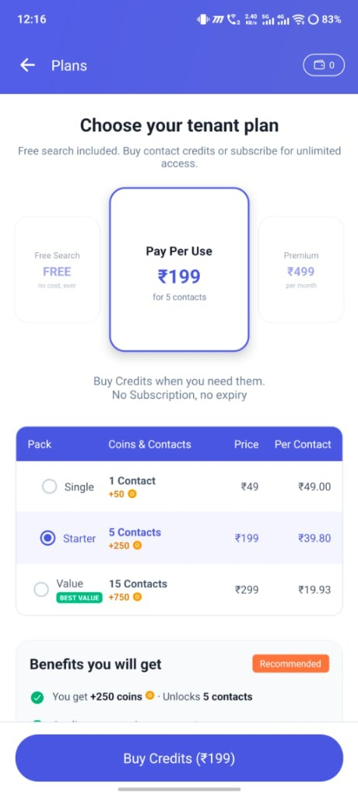

- **Monetisation & Wallet Credit System:** Flexible pay-per-use contact credit packs (Single, Starter, Value) with integrated wallet coin rewards for unlocking owner contacts without requiring monthly recurring subscriptions.

---

### 3.4 Who Uses This System

| User Role | Primary Function in Platform |
|---|---|
| **Tenant / Renter** | Search properties, filter by budget/locality, view photos/videos, contact owners |
| **Property Owner** | Post verified rental listings, track property views, manage tenant inquiries |
| **Broker / Consultant** | Manage multi-property portfolios, receive leads, track client deals |
| **Platform Administrator** | Verify listings, review property media, manage users, monitor analytics |

---

### 3.5 Key Features & Functional Modules

- **Elasticsearch Search Engine:** Full-text and geospatial search across thousands of properties.
- **Lead Generation & Reveal Engine:** Secure lead capture allowing tenants to request owner contacts.
- **Verification & Moderation Workflow:** Admin approval process for property listings before public publishing.
- **Multi-Channel Notifications:** Instant lead alerts sent to owners via Firebase Push, WhatsApp API, SMS, and Email.
- **Wishlist & Property Comparison:** Saved properties and side-by-side amenity comparison.
- **Media Upload Pipeline:** Image compression and cloud storage upload to AWS S3.

---

| Area | Technology Used |
|---|---|
| **Backend Language & Framework** | Java 17, Spring Boot 3.5.0 |
| **Mobile App Platform** | React Native 0.86.0 (React 19.2.3, TypeScript 5.8) |
| **Mobile State & Data Fetching** | Redux Toolkit 2.12 + TanStack React Query 5.101 |
| **Mobile Navigation & UI** | React Navigation 7.x (Native Stack & Bottom Tabs), Safe Area Context, Screens |
| **Mobile Forms & Validation** | React Hook Form 7.79 + Hookform Resolvers 5.4 |
| **Mobile Maps & Location** | React Native Maps 1.27 + Community Geolocation 3.4 |
| **Mobile Payments** | React Native Razorpay SDK 2.3 |
| **Mobile Cloud & Push** | React Native Firebase (App & Messaging 26.2) |
| **Mobile Storage & Security** | Async Storage 3.1 + React Native Keychain 10.0 |
| **Mobile Media & Vector Graphics** | Image Picker 7.1 + SVG & Vector Icons 10.3 + Linear Gradient |
| **Database & Search Engine** | PostgreSQL, Elasticsearch |
| **Caching Layer** | Redis + Caffeine (2-level cache) |
| **Backend Security** | JWT (RS256) with Spring Security |
| **Email & Cloud Services** | SendGrid + AWS SES + AWS S3 SDK |
| **Deployment** | Docker + Docker Compose + Nginx |

---

## PART 4 — PROJECT COMPARISON

| Dimension | EmiratesErp Platform | Emirates Laundry System | Rentellor Marketplace |
|---|---|---|---|
| **Business Domain** | Multi-company service ERP | Professional laundry operations | Property rental marketplace |
| **Data Isolation Model** | Separate database per company | Company/branch scoping | PostgreSQL database + Elasticsearch index |
| **Primary Output** | Payslips, invoices, reports | Garment QR tracking, QC, invoices | Property listings, search, owner leads |
| **Search Engine** | MySQL JPA queries | MySQL JPA queries | High-speed Elasticsearch search |
| **Third-Party Integrations** | Biometric devices, Email, WhatsApp, Telegram | Firebase, AWS S3, AWS Rekognition, WhatsApp | Elasticsearch, AWS S3, Firebase, Razorpay, SendGrid |
| **Deployment** | Docker Compose | Docker Compose | Docker Compose + Nginx |

---

## PART 5 — PROFESSIONAL SUMMARY

### What These Projects Demonstrate

**System Architecture Expertise**
Across all three platforms (Enterprise ERP, Operational Laundry, Real Estate Marketplace), core architectural decisions were made for scale, security, and domain requirements — including database-per-tenant isolation, garment QR lifecycle tracking, and sub-50ms Elasticsearch indexing.

**End-to-End Ownership**
All systems were designed, built, and deployed as a sole backend developer — covering database schemas, REST APIs, cloud integrations, payment systems, and Docker containerisation.

**Production Maturity**
All three platforms are deployed live in production, handling real operational workflows, customer transactions, and live searches.

---

## APPENDIX — SYSTEM METRICS

| Metric | EmiratesErp Platform | Emirates Laundry System | Rentellor Marketplace |
|---|---|---|---|
| Language & Version | Java 21 (Spring Boot 3.5.5) | Java 17 (Spring Boot 3.5.3) | Java 17 (Spring Boot 3.5.0) |
| Primary Database | MySQL 8.x | MySQL 8.x | PostgreSQL 15+ |
| Search / Index | MySQL JPA | MySQL JPA | Elasticsearch |
| Primary Storage | Local / Docker Volumes | AWS S3 | AWS S3 |
| Live URL | https://emirates.emirateserp.com/login | https://laundary.emirateserp.com/ | https://rentellor.com/ |

---

*This portfolio document is based on verified source code and architecture review of all three production systems.*

---

**Portfolio Prepared:** September 2026  
**Developer Location:** India
